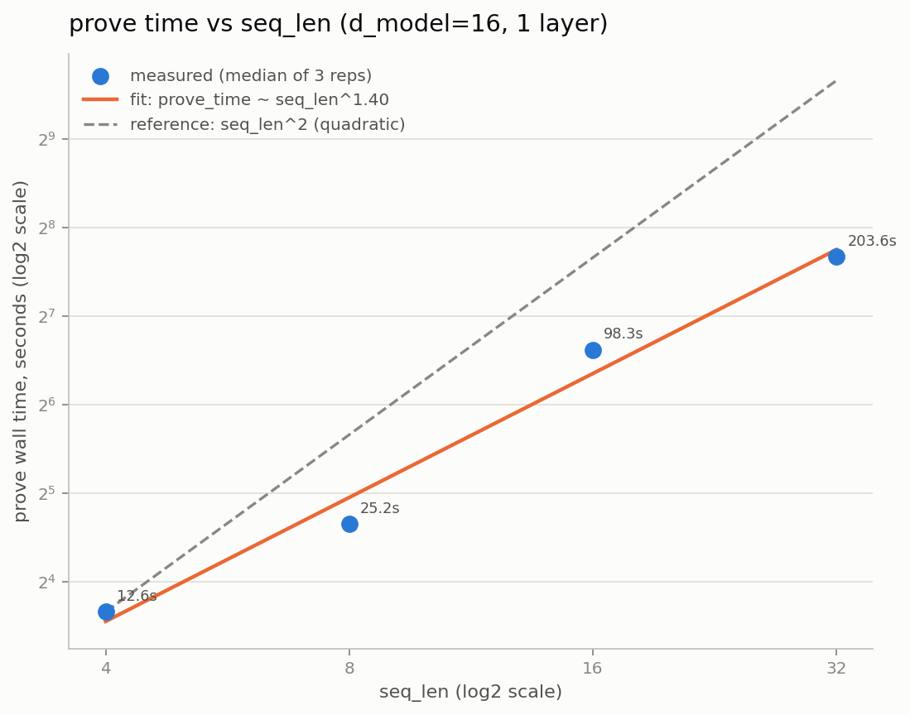
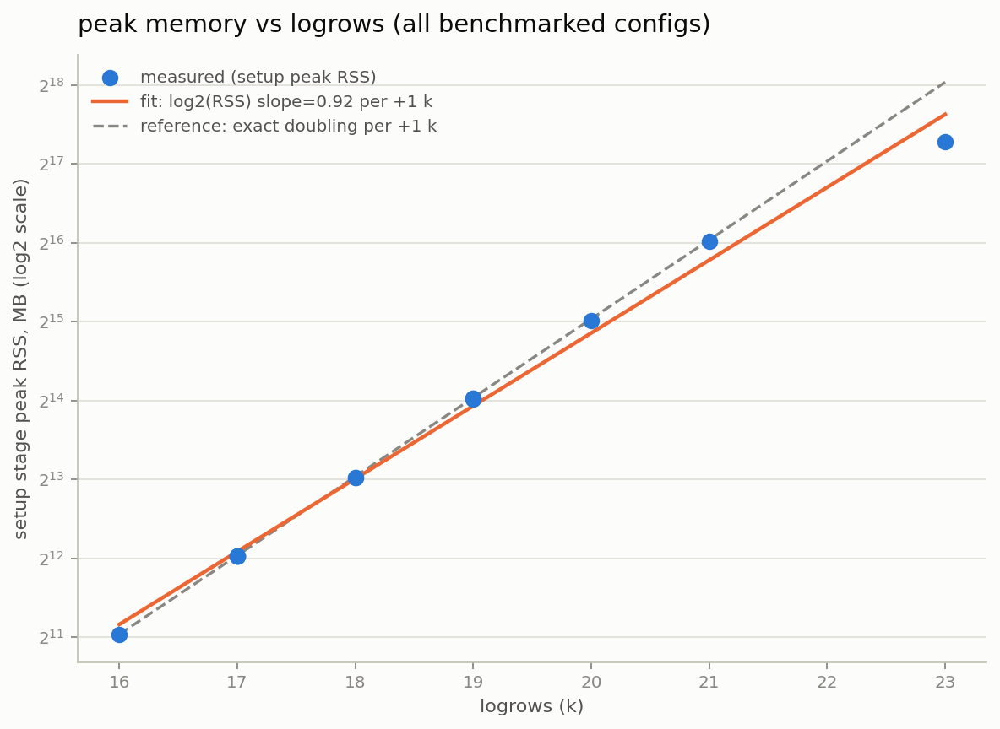
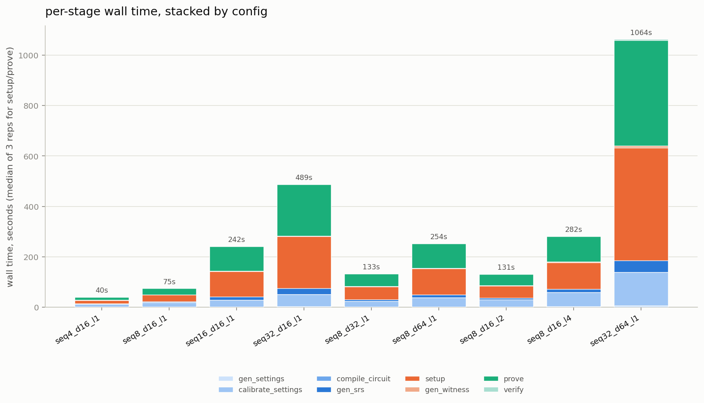
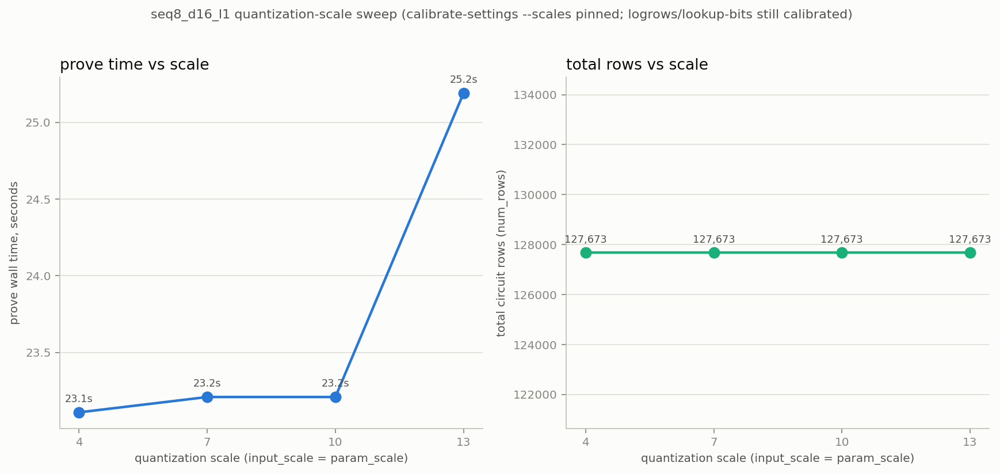

# ezkl transformer-scaling benchmark: report

Consolidates the full-matrix stage-level benchmark, a controlled quantization-scale
sweep, the `prove`-stage flamegraph breakdown, and the per-operator row/lookup
ledger into one place, ending with a priority-ordered set of bottleneck
conclusions. Source data / how-to-reproduce for every section lives in
`results/README.md`; this file is the narrative on top of it.

## Experiment environment

Full details in **[`ENV.md`](ENV.md)**. Headline facts that matter for
reading the numbers below: 64-core / 251 GiB container, `perf`/`cargo
flamegraph` don't work here (`perf_event_paranoid=4`) so profiling used the
`pprof` crate instead, and the `halo2_proofs` fork pin was bumped one commit
forward to fix a real bug that otherwise breaks `prove` on any 2+-matmul
circuit — none of this data would exist without that fix.

## 1. Full sweep — `results/summary.csv`

10 configs (seq_len scan 4/8/16/32, width scan d16/d32/d64, depth scan
l1/l2/l4, plus the pre-rescale `seq32_d64_l1`/`seq32_d256_l1` reference pair)
+ 3 quantization-scale variants (below). Every row now carries an
`overall_status` column (`OK` or `FAILED(<stage>:<reason>)`) — only
`seq32_d256_l1` is `FAILED(setup:OOM_OR_KILLED;OOM_OR_KILLED;OOM_OR_KILLED)`,
the deliberately-provoked OOM ceiling; everything else completed cleanly.

### Figure a — prove time vs seq_len

Fitted **prove_time ~ seq_len^1.40** — sub-quadratic, not the O(seq_len²) a
naive attention-complexity read would predict. The op-ledger (§3) explains
why: Q·K^T and attn·V together are only ~4.6% of circuit rows for this
architecture, so the O(n²) terms are diluted by the much larger O(n)
rescale/matmul/layernorm row cost that dominates the circuit.

### Figure b — peak memory vs logrows

Fitted slope **0.92 log2(MB) per +1 k** — essentially the expected exact
doubling. The one point below the fitted/reference line is `seq32_d256_l1`
(logrows=23): it OOM'd mid-`setup`, so its recorded "peak" is where the OOM
killer caught it, not a real converged peak — the true peak would sit on or
above the line. This is the practical ceiling in this 251 GiB container: k=23
is already unreachable, k=21 (`seq32_d64_l1`) already needs ~65 GB just for
`setup`.

### Figure c — per-stage stacked wall time

`setup` + `prove` dominate every config's total wall time (roughly 85-95% of
the stack); `calibrate_settings` is the only other stage with a visible
sliver, and it's still an order of magnitude smaller. `gen_settings`,
`compile_circuit`, `gen_srs`, `gen_witness`, `verify` are all negligible at
every scale tested.

## 2. Quantization-scale sweep (`--calibrate-scales`, controlled variable)

`seq8_d16_l1` (the sweep's base config) run 3 extra times with
`calibrate-settings --scales N` pinned to `N ∈ {4, 7, 10}` — this fixes the
scale instead of letting calibrate-settings auto-search it, while still
letting it calibrate logrows/lookup-bits normally. The 4th point (scale=13)
is the original unscaled run, where auto-calibration happened to land on 13.

### Figure d — prove time and total rows vs scale

For this architecture, **`num_rows` is completely insensitive to scale**
(127,673 rows at every one of 4/7/10/13 — logrows stays 17 throughout): row
count here is driven by tensor shapes, not by how many bits each fixed-point
value uses. `prove` time is flat across 4/7/10 (23.1-23.2s) but jumps to
25.2s at scale=13 (+~9%) — plausibly the wider lookup-table domain
(`lookup_range` spans 126 at scale=4 vs 51,104 at scale=13) costs a little
extra table-construction/lookup work even though the row *count* doesn't
change. Small effect, but real and worth knowing: **for this circuit, scale
is nearly free until it's the difference between fitting the fixed-point
representation (i128) or not** — the earlier flamegraph-scaling notes
(`.claude/ezkl_create_proof_flamegraph_scaling_notes.md`) already found
`param_scale` has a *ceiling* around 13 for representability, not a
performance cliff.

## 3. Per-operator row/lookup ledger (`op_ledger.csv`, `seq8_d16_l1`)

Full methodology and a second config's cross-check in
**[`LEDGER_NOTES.md`](LEDGER_NOTES.md)**.

| category | rows | % of rows | lookup-op instances | % of instances |
|---|---|---|---|---|
| matmul (QKV/proj/FFN weight matmuls) | 26,496 | 20.8% | 0 | 0% |
| qk (Q·K^T) | 2,944 | 2.3% | 0 | 0% |
| av (attn·V) | 2,944 | 2.3% | 0 | 0% |
| softmax | 5,648 | 4.4% | 1 | 9.1% |
| gelu (tanh-approx) | 256 | 0.2% | 1 | 9.1% |
| layernorm | 13,585 | 10.6% | 0 | 0% |
| **rescale** | **73,932** | **57.9%** | **9** | **81.8%** |
| other | 1,868 | 1.5% | 0 | 0% |

**Rescale — the mandatory scale-down division after every fixed-point
multiply — is the single largest row category by a wide margin**, nearly 3x
the entire matmul family (25.4% combined). It's also the large majority
(81.8%) of lookup-table-referencing op instances (range-checks for its
base-16384 decomposition), dwarfing the two named nonlinearities (Tanh/Exp,
1 instance each).

## 4. `prove`-stage hotspot breakdown (six buckets, pprof sampling)

Full methodology, the idle-thread-noise caveat, and file-by-file breakdown in
**[`PPROF_README.md`](PPROF_README.md)**. Using the clean single-thread
measurement (`seq4_1thread` — no rayon idle-sampling contamination):

| bucket | % of prove CPU time |
|---|---|
| **FFT/NTT** | **39.1%** |
| MSM/commitment | 22.5% |
| **quotient / gate eval** | **30.7%** |
| lookup argument | 2.9% |
| permutation argument | 0.7% |
| witness/assign | 0.7% |
| other | 3.4% |

FFT/NTT + quotient/gate-eval together are **~70% of prove's CPU time**. Both
scale with the polynomial domain size (`2^logrows`), i.e. with **total circuit
rows** — which is exactly the quantity §3 attributes overwhelmingly (57.9%)
to `rescale`.

## Bottleneck conclusions: optimization priority, by evidence

Putting the row ledger (§3, *where rows come from*) together with the
flamegraph (§4, *where prove's CPU time goes*) and the scaling figures (§1
figs a/b): the picture is one causal chain, not two unrelated bottlenecks.
`prove`'s CPU time is dominated by FFT/quotient/MSM (§4, ~92% combined), all
three of which scale with **total row count**; total row count is dominated
by `rescale` (§3, 57.9-59.5% across two configs of very different scale).
So the priority order, most to least leverage:

1. **Reduce rescale's row footprint.** This is the highest-leverage target by
   a clear margin: it's the largest single row category (~58-60%) *and*,
   through the row-count → FFT/quotient/MSM chain, the largest indirect
   driver of `prove`'s dominant CPU costs, *and* the largest driver of the
   memory-doubling-per-k ceiling (fig b) — a win here compounds across
   speed, memory, and the practical logrows ceiling simultaneously. Concrete
   angles worth investigating (not evaluated here, out of scope for this
   report): fusing consecutive multiplies to reduce how often rescale fires,
   or tuning `decomp_base`/`decomp_legs` (currently base=16384, 2 legs) —
   the scale sweep (§2) shows scale itself is nearly free until its
   representability ceiling, so the cost lives in *how the rescale
   decomposition is built*, not in the scale value.
2. **Reduce total rows generally (any category).** Because FFT (39.1%) and
   quotient (30.7%) both scale with `2^logrows`, *any* row reduction — not
   just in rescale — pays off across both of `prove`'s two biggest buckets
   at once, and (fig b) can drop the circuit into a cheaper logrows bracket
   entirely (memory and, by extension, prove/setup time roughly halve per
   -1 k).
3. **Matmul-family (QKV/FFN weight matmuls, Q·K^T, attn·V) is lower ROI than
   its "obvious target" status suggests.** It's only 25.4% of rows combined,
   and the attention-specific O(seq_len²) terms (qk+av) are a mere 4.6% —
   which is exactly why fig a's fitted seq_len exponent (1.40) came in well
   below the naive O(seq_len²) expectation. Effort spent on
   attention-complexity tricks (flash-attention-style restructuring, etc.)
   would have a smaller payoff here than the row ledger's raw op-count might
   suggest, precisely because rescale/layernorm bookkeeping — not the
   matmuls themselves — dominates.
4. **Lookup argument (Tanh/Exp) and permutation argument are not
   bottlenecks at this architecture's scale** — 2.9% and 0.7% of prove CPU
   respectively (§4), and only 2 of 11 lookup-table-referencing op instances
   (§3). Optimizing these would be effort spent on a cost center that's
   already small.

**Caveat carried over from §3/§4's own notes:** the row-share evidence for
rescale is solid (exact row accounting, cross-checked on two configs), but
the *lookup-call-count* share is an op-*instance* count, not a per-element
call count (no per-element counter exists in the current debug log — see
`LEDGER_NOTES.md`'s "What's missing" section for the two-line source-code
instrumentation that would close this gap). That doesn't change the
row-based priority ordering above, which doesn't depend on the missing
number.
